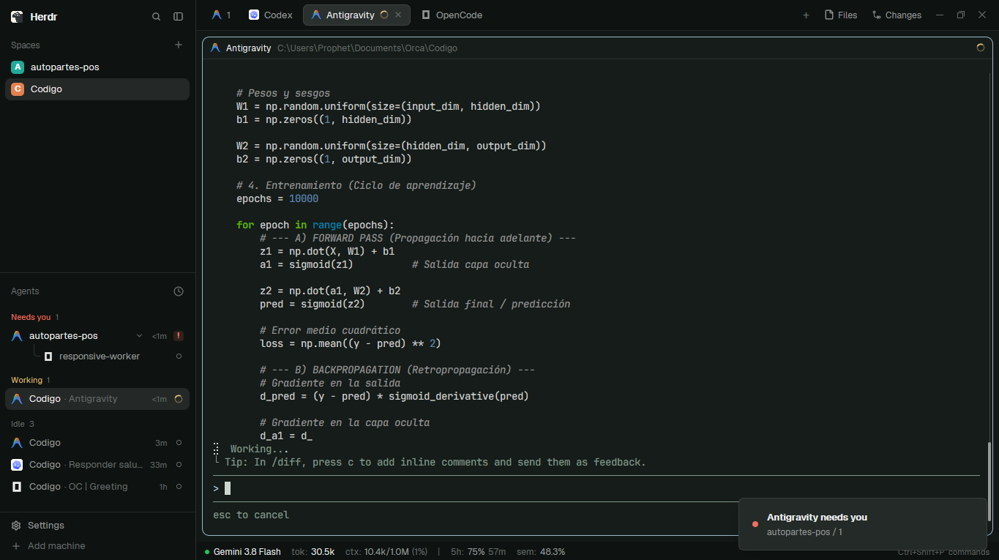
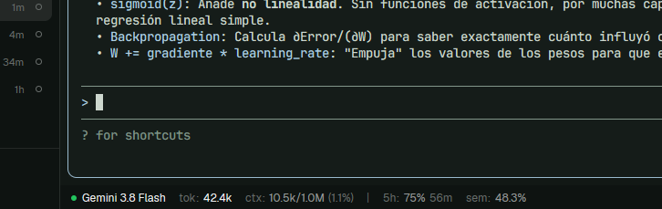

# Herdr Quota Monitor

[](https://herdr.dev)
[](LICENSE)
[](README.md)
[](README.md)

Monitor minimalista y en tiempo real para terminales y agentes de Inteligencia Artificial en **[Herdr](https://herdr.dev)**.

Diseñado para integrarse de forma limpia y sobria en la barra de estado inferior de Herdr, mostrando las métricas exactas del proyecto y terminal que estés usando en cada momento.

---

## 📸 Vista Previa (Showcase)

### 1. Vista General en Herdr
Integración limpia en la barra de estado inferior sin saturar el espacio de trabajo ni interferir con tus agentes:



### 2. Detalle de Métricas en Primer Plano
Lectura rápida y nítida de modelo activo, tokens consumidos, porcentaje de ventana de contexto y cuotas restantes:



---

## 📊 Glosario de Métricas: ¿Cómo interpretar los datos?

| Indicador | Ejemplo | Significado |
|---|---|---|
| **Modelo Activo** | `● Gemini 3.8 Flash` | El modelo de IA que está procesando la terminal actual. |
| **`tok:` (Tokens de Sesión)** | `tok: 42.4k` | Cantidad total acumulada de tokens procesados en la conversación del proyecto activo (Prompt + Respuesta + Lectura de Caché). `k` = miles, `M` = millones. |
| **`ctx:` (Ventana de Contexto)** | `ctx: 10.5k/1.0M (1.1%)` | **Contexto actual ocupado frente al límite máximo del modelo**. Indica cuánta memoria de conversación tiene cargada en este turno específico y qué porcentaje representa del límite total admitido (ej. 1 millón en Gemini Flash). Te avisa si estás cerca del umbral de compactación. |
| **`5h:` (Cuota de 5 Horas)** | `5h: 75% 56m` | **Porcentaje disponible restante** en tu ventana deslizante de 5 horas. El valor posterior (`56m`) indica el tiempo exacto que falta para que el turno más antiguo de la ventana expire y comiences a recuperar cuota. |
| **`sem:` (Cuota Semanal)** | `sem: 48.3%` | **Porcentaje disponible restante** de tu presupuesto semanal oficial de uso de tu cuenta o plan. |

### 🎨 Código de Colores Semántico:
- **Color atenuado / sutil**: Cuota saludable (más del 30% restante).
- **Amarillo (`#eab308`)**: Advertencia (te queda entre el 15% y 30%).
- **Rojo (`#ef4444`)**: Cuota crítica (menos del 15% restante).

---

## ✨ Características Principales

1. **Soporte Multisesión y Multiterminal**:
   - Cambia dinámicamente entre pestañas y espacios de Herdr. Si pasas de un proyecto `Frontend` a uno `Backend`, los contadores de `tok` y `ctx` cambian instantáneamente para reflejar ese proyecto en específico.

2. **Cero Latencia (Zero-Polling Event-Driven)**:
   - Utiliza el motor nativo de eventos de sistema de archivos de Herdr (`watchFolder`). En cuanto el agente genera tokens o actualiza su estado, la barra se repinta en menos de 16 milisegundos sin consumir CPU en bucles innecesarios.

3. **Arquitectura Universal de Adaptadores**:
   - **Antigravity**: Consulta oficial sincronizada con el backend local (`RetrieveUserQuotaSummary`).
   - **OpenCode**: Detección automática de sesiones, tokens de entrada/salida/caché y proyectos asociados.
   - **Claude Code**: Adaptador para consumo y límites de `~/.claude/`.
   - **Open Standard**: Cualquier CLI o agente propio puede emitir métricas escribiendo un JSON en `~/.config/herdr-app/data/custom_agent_quota.json`.

---

## 🚀 Instalación

### Método 1: Con un Agente de Herdr (Recomendado)
Copia y pega la siguiente instrucción estándar en la terminal de cualquier agente dentro de Herdr:

```text
Read ~/.config/herdr-app/AGENTS.md, then add this mod: github.com/prophetmalik/herdr-quota-monitor
```

O si prefieres guiarlo paso a paso:
```text
Lee https://github.com/prophetmalik/herdr-quota-monitor y sigue las instrucciones de su archivo RECIPE.md para instalar el mod herdr-quota-monitor.
```

### Método 2: Instalador Automático (Windows)
Haz doble clic en `install.bat` o ejecuta en PowerShell:
```powershell
powershell -ExecutionPolicy Bypass -File .\install.ps1
```

### Método 3: Instalación Manual
1. Copia `main.js`, `mod.json` y `collector.py` dentro de:
   `~/.config/herdr-app/mods/agent-quota-bar/`
2. Copia `main.js` también en:
   `~/.config/herdr-app/mods/workspace-status/main.js`
3. Ejecuta una vez el recolector para sembrar los datos iniciales:
   ```bash
   python ~/.config/herdr-app/mods/agent-quota-bar/collector.py
   ```

---

## 🗑️ Desinstalación

### ¿Cómo desinstalar un mod en Herdr?
En Herdr, los mods residen en la carpeta de configuración del usuario: `~/.config/herdr-app/mods/<nombre-del-mod>/`.
- Si modificaste un mod nativo que venía de fábrica con Herdr (como `workspace-status`), simplemente borra su carpeta: al reiniciar Herdr, el sistema detecta que falta y vuelve a extraer automáticamente la versión original de fábrica intacta.
- También puedes presionar la combinación de teclas de emergencia de Herdr: `Ctrl + Alt + Shift + Esc` para restablecer los layouts a su configuración por defecto.

### Desinstalación de Herdr Quota Monitor:

#### Opción 1: Automática (Windows)
Haz doble clic en `uninstall.bat` o ejecuta en PowerShell:
```powershell
powershell -ExecutionPolicy Bypass -File .\uninstall.ps1
```

#### Opción 2: Manual (PowerShell)
```powershell
# 1. Eliminar la carpeta del mod
Remove-Item -Recurse -Force "$HOME\.config\herdr-app\mods\agent-quota-bar"

# 2. Restaurar la barra original de Herdr (se regenera de fábrica al reiniciar)
Remove-Item -Recurse -Force "$HOME\.config\herdr-app\mods\workspace-status"

# 3. Limpiar archivos de métricas temporales
Remove-Item -Force "$HOME\.config\herdr-app\data\agent_quota.json"
Remove-Item -Force "$HOME\.config\herdr-app\data\.hub_cache.json"
```

---

## 📄 Licencia

Este proyecto está bajo la Licencia MIT. Consulta el archivo [LICENSE](LICENSE) para más detalles.
