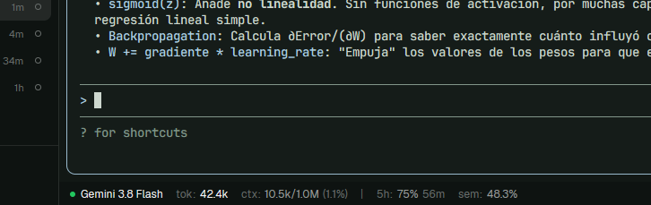

# Herdr Quota Monitor

A minimalist real-time token, context window, and 5-hour/weekly quota monitor mod for AI coding agents running in Herdr.

## What you see
A clean, single-row status bar integrated at the bottom of the active workspace window (height: 28px, full width) separated into clean, subtle partitions:
- **Left segment:** Machine label (`This computer`) and active git branch (`branch main`).
- **Center segment (AI Session & Context):** A subtle bullet dot with the active AI model name (`● Gemini 3.8 Flash`), followed by session tokens (`tok: 18.7M`) and context window usage with percentage (`ctx: 207k/1.0M (20.8%)`).
- **Right segment (Account Quotas):** Rolling 5-hour limit remaining percentage with reset countdown (`5h: 65% · 24m`) and weekly quota remaining (`sem: 56%`).
- **Far right segment:** Keyboard shortcut palette helper (`commands`).
- **Color semantics:** Default subtle foreground text for healthy quotas (> 30%); transitions to yellow (`#eab308`) when quota drops between 15% and 30%; transitions to red (`#ef4444`) when quota falls below 15%.

## How it behaves
- **Multiterminal and workspace awareness:** Automatically inspects `focused().cwd` and active spaces (`spaces()`). When switching between terminal tabs or project spaces, the session token count and context metrics switch dynamically in real time to match the focused workspace.
- **Zero latency reactivity:** Uses `watchFolder("~/.config/herdr-app/data")` to subscribe directly to file system events. Whenever new tokens are generated or the agent state is updated, Herdr repaints the status bar within 16 milliseconds without CPU polling loops.
- **Passive fallback:** Background timer refreshes every 4 seconds to update reset minute countdowns.

## Built from
- **GPUI component:** `mods/agent-quota-bar/main.js` exporting `WorkspaceStatus` extending `View` from `gpui-kit`.
- **Manifest:** `mods/agent-quota-bar/mod.json` declaring mod `herdr-quota-monitor` with `"place": "none"`.
- **Herdr APIs used:** `spaces`, `agents`, `focused`, `theme`, `keys`, `readTextFile`, `watchFolder`, `appHome`, `exec`.
- **Collector program:** `mods/agent-quota-bar/collector.py` querying local Antigravity Language Server RPC (`/RetrieveUserQuotaSummary`) and conversation summaries with fallback adapters for Claude and custom JSON agents.

## Watch out
- Requires Python 3 installed on the host machine to execute `collector.py`.
- On Windows, process discovery for `agy.exe` command-line flags uses PowerShell CIM queries; credentials (`port` and `csrf`) are automatically cached in `~/.config/herdr-app/data/.hub_cache.json` for subsequent sub-10ms reads.

## Done when
1. `herdr-app check ~/.config/herdr-app/mods/agent-quota-bar` exits with 0 and no errors.
2. The bottom bar displays the active model name, accumulated session tokens, and quota percentages.
3. Switching between project spaces automatically updates the context and token counters.
